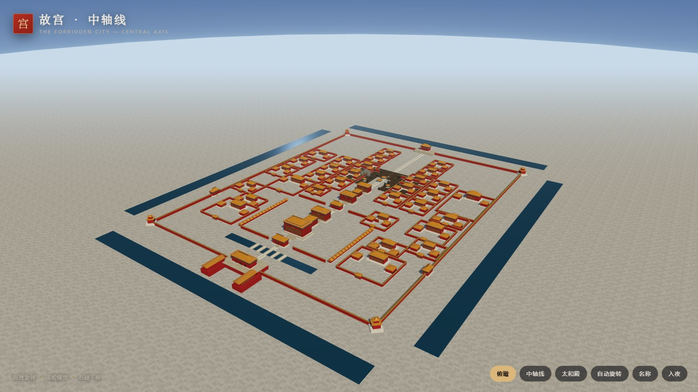
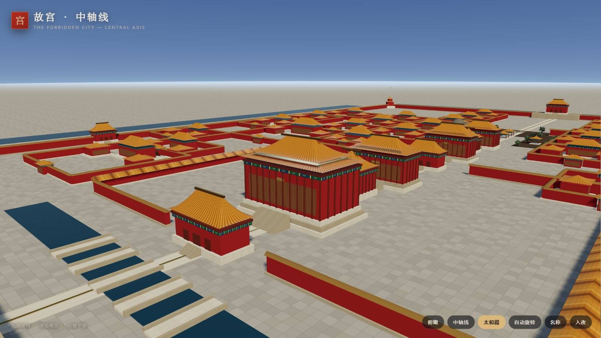
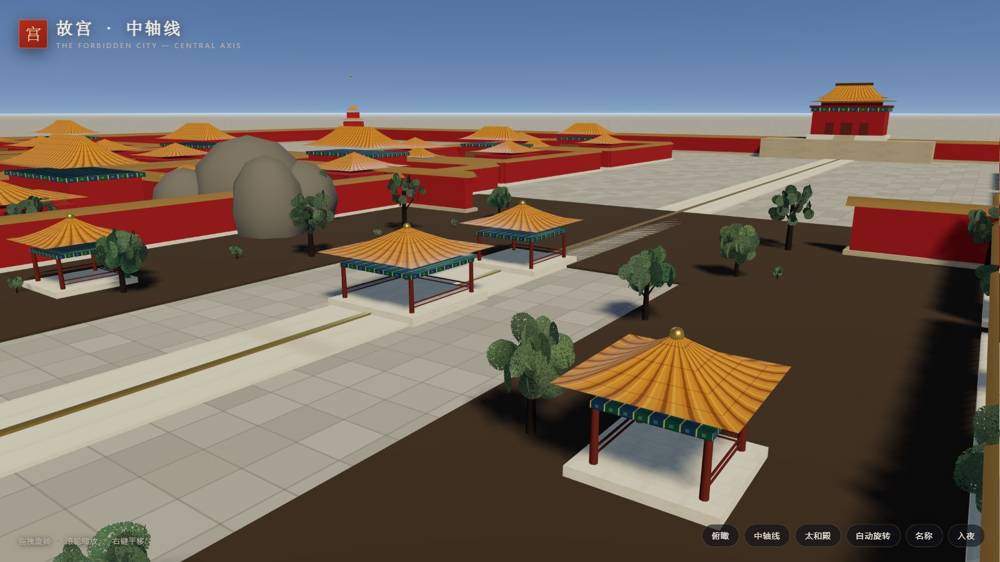
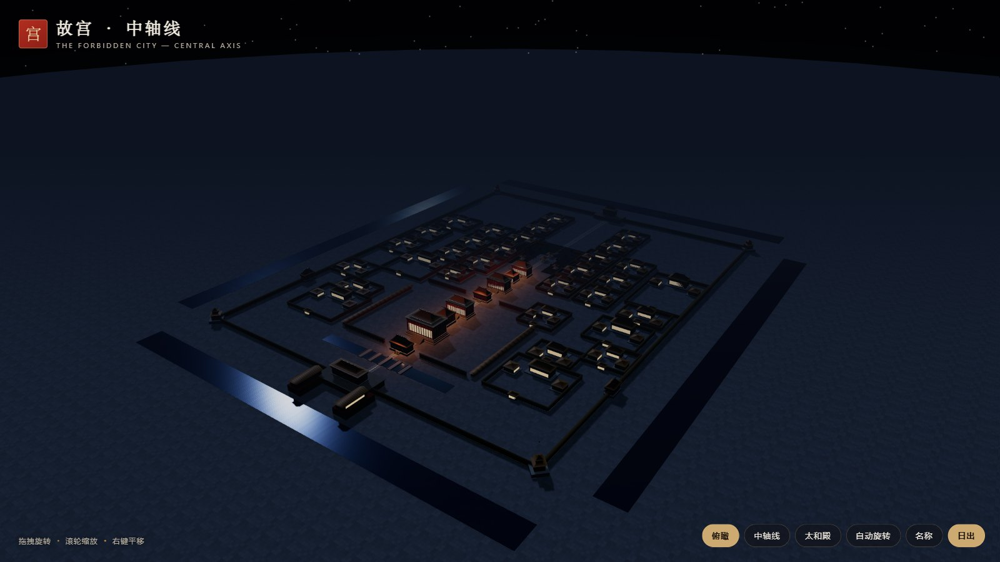

# 故宫 · 中轴线 3D

An interactive, procedural reconstruction of the Forbidden City's central axis —
午门 → 太和门 → 太和殿 → 中和殿 → 保和殿 → 乾清门 → 乾清宫 → 坤宁宫 → 御花园 → 神武门,
plus the eastern and western courtyards laid out from the palace plan.

Everything you see is generated in code at runtime: no model files, no texture
images, no build step, no CDN. The whole thing is a static site you can open
offline.



## What's inside

- **The axis** — 午门 with its 雁翅楼 wings, 太和门, the three great halls on their
  tiered 汉白玉 terraces, the inner court, 御花园 and 神武门.
- **31 walled courtyards** — 东六宫 / 西六宫, 宁寿宫, 慈宁宫, 寿康宫, 文华殿,
  武英殿, 奉先殿, 养心殿 and the service courts, positioned from the plan and
  validated so none of them overlap.
- **Procedural architecture** — hip roofs (庑殿) and pyramidal roofs (攒尖) are
  lofted from a shrinking perimeter, which is what gives the eaves their upturn.
  Double eaves, colonnades, 彩画 bands, lattice doors, terraces and stairs are
  generated per building.
- **Procedural trees** — trunks and branches with a canopy built from
  alpha-cut leaf cards, in three species (古柏 / 松 / 阔叶). They keep their
  silhouette at any zoom instead of turning into spheres.
- **Material relief** — paving joints, ashlar courses and roof tile ribs get
  normal maps derived from the same canvases that paint them.
- **Day / night** — a baked gradient-sky environment map drives reflections on
  water and gilt; night adds a warm window glow, lantern pools and stars.

| 太和殿 | 御花园 | 入夜 |
| --- | --- | --- |
|  |  |  |

## Run it

```bash
# any static server works; the page is plain ES modules
python -m http.server 8000
# then open http://localhost:8000
```

No install, no bundler, no `node_modules`. Three.js is vendored in `vendor/`.

## Using it

| Input | Action |
| --- | --- |
| drag / wheel / right-drag | orbit, zoom, pan |
| `1` `2` `3` | overview, axis, 太和殿 |
| `N` / `L` | night, labels |

Camera states are deep-linkable: `?view=overview|axis|taihe|garden` and `&night=1`.

## Layout validation

The courtyard table in [`js/layout.js`](js/layout.js) is checked by a script —
no two courtyards may overlap, nothing may spill outside the wall, nothing may
sit on the axis:

```bash
node tools/check-layout.mjs
# courtyards: 31
# layout OK
```

## Structure

```
index.html          import map + HUD
css/style.css       overlay UI
js/main.js          bootstrap, camera flights, UI, deep links
js/scene.js         renderer, sky shader, IBL, lights, day/night
js/materials.js     procedural textures + normal maps
js/geometry.js      hip / gable roof lofts, box helpers
js/buildings.js     halls, gates, corridors, corner towers, pavilions, walls
js/districts.js     one walled courtyard, merged into a few draw calls
js/layout.js        the courtyard table + overlap validator
js/trees.js         procedural trees (leaf-card canopies)
js/city.js          the palace itself
vendor/             three.js r169 + OrbitControls + BufferGeometryUtils
tools/              asset builders and the layout check
```

## Fidelity

This is an interpretive model, not a survey. Positions and sizes are traced
from published plans and photographs and compressed slightly so the axis reads
in one view; roofs are lofted approximations of 庑殿/歇山 forms rather than
measured carpentry. It is meant for orientation, teaching and atmosphere.

## Performance

~740 meshes, ~160k triangles, 2048² shadow map — about 55 fps on a mid-range
laptop GPU at 1600×900. Courtyards merge their walls, roofs and stonework into
a handful of draw calls each; that merge is why 31 courtyards are affordable.

## License

MIT — see [LICENSE](LICENSE).

Three.js is MIT licensed and vendored unmodified.
